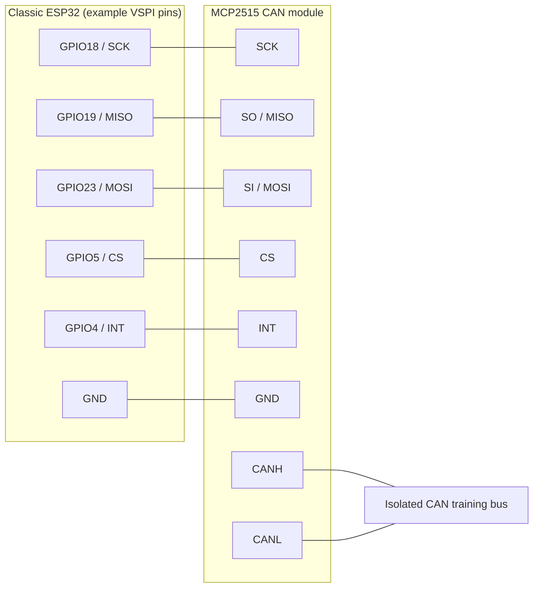

# Proposed Circuit Diagram — CAN Bus Monitoring Prototype

> This diagram documents the receive-only starter firmware assumptions. Verify your ESP32 board and MCP2515 breakout before wiring. Use an isolated training CAN network only.

## ESP32 to MCP2515 SPI connections

## Connection table

| MCP2515 pin | Example ESP32 pin |
|---|---:|
| SCK | GPIO18 |
| SO / MISO | GPIO19 |
| SI / MOSI | GPIO23 |
| CS | GPIO5 |
| INT | GPIO4 |
| GND | GND |
| VCC | Per exact module specification |

## CAN bus notes

- Match the CAN bitrate across all training nodes.
- Confirm the MCP2515 oscillator frequency (8 MHz or 16 MHz).
- Use a suitable CAN transceiver and proper termination at the two ends of the bus.
- Check the module's supply and logic-level requirements; ESP32 GPIO is not 5 V tolerant.
- Do not assume every board labelled MCP2515 has identical pin order or voltage compatibility.

## Safety and scope

The uploaded firmware is receive-only. Keep the setup isolated from vehicle wiring and vehicle networks. Do not use this prototype to transmit disruptive frames or interfere with vehicle operation.

## Verification checklist

- [ ] Confirm ESP32 board model and pin mapping.
- [ ] Confirm MCP2515 oscillator frequency.
- [ ] Confirm module logic-level compatibility.
- [ ] Confirm bitrate and bus termination on the isolated test setup.
- [ ] Verify wiring with power disconnected.
- [ ] Confirm receive-only operation using authorized lab test traffic.
