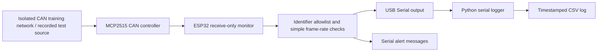

# System Architecture — CAN Bus Intrusion Monitoring Prototype

## Functional block diagram

## Data flow

1. A dedicated isolated CAN training setup provides known test traffic.
2. MCP2515 receives frames and passes them to the ESP32.
3. The ESP32 reports received identifiers and payload bytes.
4. A simple example allowlist check flags identifiers not included in the configured list.
5. A basic frame-count threshold can report unusually high message volume.
6. Python reads serial output and records observations in a CSV file.

## Current implementation scope

The uploaded firmware is receive-only. It does not inject frames, alter messages, or connect to vehicle control functions. The allowlist and frame-rate checks are demonstration logic, not a validated intrusion detection model. Detection performance must be measured against a documented, labeled lab dataset.

## Design assumptions

- Controller: ESP32
- CAN interface: MCP2515 module
- SPI pins: SCK 18, MISO 19, MOSI 23, CS 5 (verify board)
- Interrupt input: GPIO4
- Example bitrate: 500 kbit/s
- Example oscillator: 8 MHz (verify module)
- Serial link: 115200 baud
- Host logger: Python 3 with pyserial

Use only an isolated lab network or recorded data. Do not connect this educational prototype to a live vehicle network.
